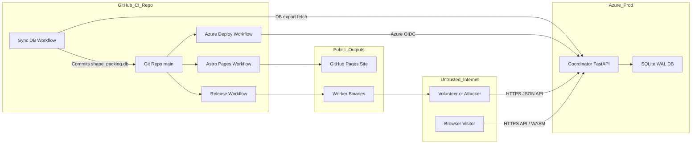

# Shape Packing Threat Model

## Executive Summary
The `shape-packing` platform links an Azure App Service FastAPI/SQLite coordinator (`shape-packing-ggd4d5e8c2ctggam.eastus-01.azurewebsites.net`), unauthenticated native Rust/Python and browser WebAssembly workers, and automated GitHub Actions workflows that deploy the backend, sync the SQLite database to `main`, publish the Astro dashboard to GitHub Pages, and release standalone worker executables. Currently, the coordinator lacks request authentication, payload/rate limits, and fail-closed backup authorization, while the frontend permits arbitrary `?coordinator=` overrides and interpolates `work.problem` into `innerHTML`. The primary risks before public recruitment are Azure Free F1 CPU/RAM exhaustion (DoS), unauthenticated DB export and automated `main`/Pages poisoning, leaderboard/lease sabotage, and browser DOM XSS.

## Scope and Assumptions
- **In-scope:** Coordinator API and SQLite persistence (`src/shape_packing/server/*`), geometric verifier (`src/shape_packing/solution_tools.py`), Python/Rust workers (`src/shape_packing/client/*`, `packer_rs/src/worker/*`, `packer_rs/src/bin/worker.rs`, `packer_rs/src/wasm.rs`), Astro frontend (`site/src/*`), CI/CD pipelines (`.github/workflows/*.yml`), and dependency manifests.
- **Out-of-scope:** Azure subscription IAM configuration, GitHub repository branch protection settings (configured outside git), and mathematical optimality of packing heuristics beyond SAT verification soundness.
- **Assumptions requiring user confirmation:**
  1. `SHAPE_PACKING_BACKUP_TOKEN` is currently unset in Azure App Service (fail-open `/api/v1/export/db`).
  2. Public anonymous volunteers (native binaries and browser WASM) will connect without manual account pre-approval.
  3. GitHub Pages is served under `https://targed.github.io/shape-packing` (repo `origin` is `targed/shape-packing`), even though `site/astro.config.mjs:7` lists `https://erich-friedman.github.io`.

## System Model & Trust Boundaries

### Primary Boundaries
1. **Untrusted Internet -> Azure Coordinator (`app.py`, `database.py`, `scheduler.py`):** Open HTTPS API with `allow_origins=["*"]` + `allow_credentials=True` + `allow_private_network=True`, zero rate limiting, zero worker auth.
2. **Untrusted URL / Coordinator -> Victim Browser (`site/src/lib/api.ts`, `contribute.astro`):** `?coordinator=` accepted unvalidated; `data.problem` rendered via `left.innerHTML` (`contribute.astro:374`).
3. **Azure Coordinator -> `sync-azure-db.yml` -> `main` -> GitHub Pages:** Fail-open `/api/v1/export/db` pulled via `curl -fSL` without auth token and pushed straight to `main`, triggering `deploy-astro.yml`.
4. **CI Runners -> Azure Prod / GitHub Releases:** Unpinned third-party Actions tags (`@v4`, `@v5`, `@stable`), unpinned `pip install -r requirements.txt` ignoring `uv.lock`, `npm ci || npm install` lockfile fallback, `cargo build` without `--locked`, and unsigned binaries.

## Assets
- **Authoritative Solution Database (`shape_packing.db` on `/home/data/` and Git):** World-record solutions, problem tiers, and worker statistics (Integrity, Availability).
- **Azure App Service Free F1 Compute Budget (60 CPU min/day, 1 GB RAM) & OIDC Credentials:** Availability of the live coordinator and integrity of code/DB in production.
- **GitHub `main` Branch, GitHub Pages Origin (`targed.github.io`), & Worker Binaries (`shape-packing-worker`):** Integrity of dashboard and volunteer client code.

## Top Abuse Paths & Threat Table

| ID | Abuse Path / Threat | Evidence | Likelihood | Impact | Priority |
|---|---|---|---|---|---|
| TM-01 | Unauthenticated `/api/v1/export/db` fail-open exposure + RAM buffering (`f.read()`) + automated DB sync poisoning to `main` and GitHub Pages | `src/shape_packing/server/app.py:603-632`; `.github/workflows/sync-azure-db.yml:20-34` | High | High | **Critical/High** |
| TM-02 | Crafted `?coordinator=` URL + unescaped `left.innerHTML` for `work.problem` -> DOM XSS in GitHub Pages origin | `site/src/lib/api.ts:40-44`; `site/src/pages/contribute.astro:374` | Medium | High | **High** |
| TM-03 | Unauthenticated `/api/v1/solutions` flood (unbounded body, temp-file disk I/O, quadratic SAT without fast-fail) or `/export/db` flood exhausting Azure F1 60 CPU-min/day | `src/shape_packing/server/app.py:214-357, 603-632`; `src/shape_packing/solution_tools.py:541-606` | High | High | **High** |
| TM-04 | Unauthenticated worker spoofing (`/workers/register` overwrite, `/deregister` DoS), fake `2**62` `attempts_completed` on `/heartbeat`, and 7-day (`604800s`) lease hoarding | `src/shape_packing/server/app.py:46-68, 129-212, 359-397`; `scheduler.py:69, 288, 323-333`; `database.py:189-200` | High | Medium | **High** |
| TM-05 | `verify_solution` accepts `N <= 0` and `NaN` values as `valid=True`, plus `VERIFY_SAT_TOLERANCE == RECORD_MIN_IMPROVEMENT` (`1e-5`) and `cli.py` ignores invalid result before git commit | `src/shape_packing/solution_tools.py:88-151, 541-606`; `packing_config.py:46-48`; `cli.py:193-205` | Medium | Medium | **Medium** |
| TM-06 | Supply-chain & CI/CD exposure: mutable Action tags, `npm ci \|\| npm install`, unpinned Python deps (`uv.lock` unused), omitted `cargo --locked`, over-scoped workflow `permissions:`, unsigned releases | `.github/workflows/main_shape-packing.yml`, `deploy-astro.yml`, `release.yml` | Low | Critical | **Medium** |
| TM-07 | Client/binary pitfalls: Rust `Duration::from_secs_f64(NaN)` panic + sleeping thread leak, `cmd /c start` shell call, missing URL-encoding/scheme check & `0o600` in Python client, broken `src.` autostart path | `packer_rs/src/solver.rs:87`; `bin/worker.rs:141-143`; `src/shape_packing/client/native_worker.py:149, 249, 536`; `autostart.py:30, 128` | Medium | Medium | **Medium** |
