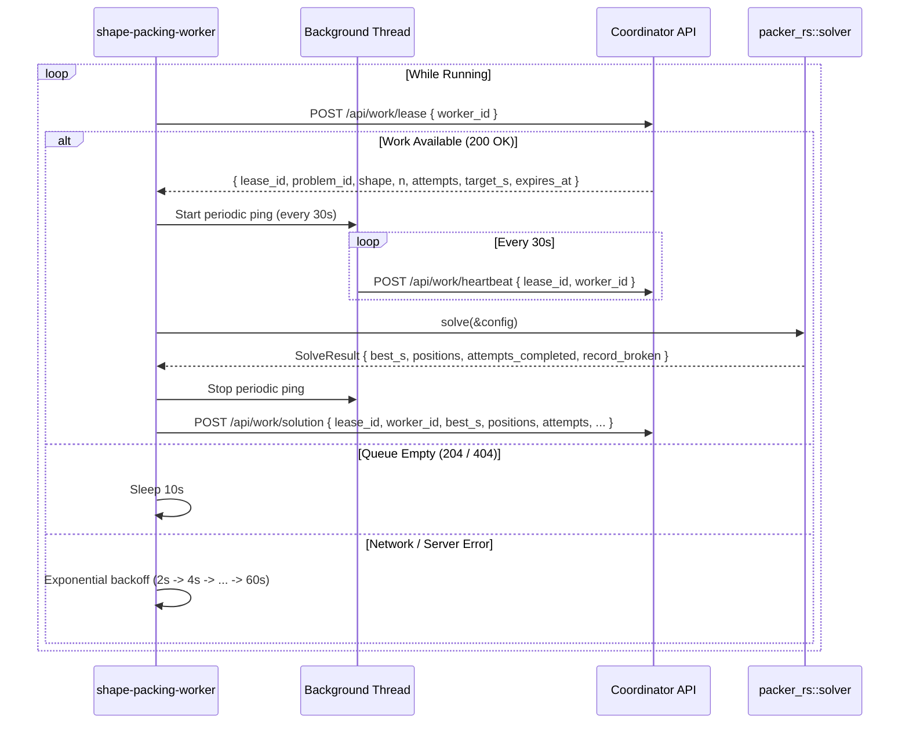

# Pure Rust Standalone Worker & GitHub Releases Design

**Status:** Approved in Brainstorming  
**Date:** 2026-11-23  
**Target:** Distributed Shape Packing Volunteer Computing Platform  
**Component:** `packer_rs` (new binary: `shape-packing-worker`), `.github/workflows/release.yml`

---

## 1. Executive Summary

To make distributed computing accessible to non-technical volunteers worldwide, the client runtime must be completely free of manual repository cloning, Python environment setup, Rust compiler installation, or terminal wrangling.

This specification defines a **pure Rust, standalone volunteer worker binary** (`shape-packing-worker` / `shape-packing-worker.exe`) and an automated **multi-platform GitHub Releases CI/CD pipeline**. The worker is a lightweight (~4 MB), self-contained executable that directly links `packer_rs::solver`, communicates with the central coordinator over HTTP, runs multithreaded packing computations across all available CPU cores via Rayon, supports interactive first-run onboarding, handles background heartbeats and signal termination gracefully, and provides native cross-platform autostart.

---

## 2. Volunteer UX & Architecture

### 2.1 Target Binary & Footprint
- **Crate:** Defined in `packer_rs/Cargo.toml` as:
  ```toml
  [[bin]]
  name = "shape-packing-worker"
  path = "src/bin/worker.rs"
  ```
- **Size & Performance:** ~3–5 MB release binary, zero shared libraries required (statically linked C runtime where possible, rustls for TLS).
- **Native Efficiency:** Directly calls `packer_rs::solver::solve(&config)` in Rust memory. Bypasses Python, PyO3, and the Global Interpreter Lock (GIL) entirely.

### 2.2 First-Run & Interactive Wizard
- **Configuration File:** `~/.shape_packing_worker.json` (stored in user home directory).
  - Compatible with desktop GUI / client configuration keys.
- **Workflow:**
  1. When executed, the worker checks if `~/.shape_packing_worker.json` exists.
  2. **If exists:** Automatically loads settings, connects to coordinator, and begins crunching immediately.
  3. **If missing & running interactively:** Prompts user via console:
     ```text
     =============================================
         Distributed Shape Packing Worker Setup
     =============================================
     [?] Coordinator Server URL [http://localhost:8000]: 
     [?] Volunteer Username [username]: 
     [?] Allocated CPU Cores (1-24) [24]: 
     Settings saved to ~/.shape_packing_worker.json
     Connecting to coordinator...
     ```
  4. **Non-interactive / Headless mode:** If standard input is not a TTY or `--no-interactive` is passed, missing settings fall back to environment variables (`SHAPE_PACKING_SERVER`, `SHAPE_PACKING_USERNAME`, `SHAPE_PACKING_CORES`) or fail with an actionable error message.

### 2.3 CLI Flags & Commands (`clap`)
```text
Usage: shape-packing-worker [OPTIONS] [COMMAND]

Commands:
  autostart   Manage automatic startup on system boot (enable, disable, status)
  help        Print this message or the help of the given subcommand(s)

Options:
  -s, --server <URL>            Coordinator server base URL
  -u, --username <NAME>         Volunteer username for credit/leaderboard
  -c, --cores <N>               Number of CPU cores to allocate [default: all]
      --config <PATH>           Custom configuration file path
      --no-interactive          Disable interactive prompt if configuration is missing
  -h, --help                    Print help
  -V, --version                 Print version
```

---

## 3. Network Protocol & Worker Lifecycle

The standalone worker uses `ureq` (synchronous HTTP client with `json` feature) to communicate with the coordinator API.

### 3.1 Worker Registration
- **Endpoint:** `POST /api/workers/register`
- **Payload:**
  ```json
  {
    "worker_id": "c6218f77-51ff-4cbb-bb9f-3ef2f327de8f",
    "username": "alice",
    "cores": 8,
    "platform": "windows/x86_64",
    "client_version": "0.1.0"
  }
  ```
- **Response:** `200 OK` with `worker_id` and assigned parameters. If `worker_id` was absent, client persists the newly generated UUID into `~/.shape_packing_worker.json`.

### 3.2 Main Crunch Loop


### 3.3 Graceful Signal Handling
- Listens for `SIGINT` (Ctrl+C) and `SIGTERM` via `ctrlc` crate.
- Sets an `AtomicBool` running flag to `false`.
- If a task is actively computing:
  - Immediately stops the heartbeat thread.
  - Issues `POST /api/workers/deregister` (`{"worker_id": "..."}`) to release active leases back to the pool.
  - Exits cleanly with code 0.

---

## 4. Cross-Platform Autostart Integration

The worker binary implements the `autostart` subcommand without requiring external tools:

1. **Windows:**
   - Registry path: `HKEY_CURRENT_USER\Software\Microsoft\Windows\CurrentVersion\Run`
   - Value name: `ShapePackingWorker`
   - Value string: `"<EXE_PATH>"`
2. **Linux:**
   - XDG autostart file: `~/.config/autostart/shape-packing-worker.desktop`
   - Contains:
     ```desktop
     [Desktop Entry]
     Type=Application
     Name=Shape Packing Worker
     Exec=<EXE_PATH>
     Terminal=false
     ```
3. **macOS:**
   - LaunchAgent plist: `~/Library/LaunchAgents/com.shapepacking.worker.plist`
   - Configured with `RunAtLoad = true` and `KeepAlive = false`.

Subcommand actions:
- `shape-packing-worker autostart enable`
- `shape-packing-worker autostart disable`
- `shape-packing-worker autostart status`

---

## 5. Multi-Platform Release CI/CD Pipeline

Automated packaging via GitHub Actions (`.github/workflows/release.yml`).

### 5.1 Trigger Conditions
- Git tag creation matching `v*` (e.g. `v0.1.0`).
- Manual trigger via `workflow_dispatch`.

### 5.2 Build Matrix
| Target Platform | Runner | Cargo Target | Artifact Name | Archive Format |
| :--- | :--- | :--- | :--- | :--- |
| **Windows x86_64** | `windows-latest` | `x86_64-pc-windows-msvc` | `shape-packing-worker-windows-x86_64.zip` | `.zip` (contains `.exe` + README) |
| **Linux x86_64** | `ubuntu-latest` | `x86_64-unknown-linux-gnu` | `shape-packing-worker-linux-x86_64.tar.gz` | `.tar.gz` (contains binary + README) |
| **macOS Universal** | `macos-latest` | `x86_64-apple-darwin` & `aarch64-apple-darwin` | `shape-packing-worker-macos-universal.tar.gz` | `.tar.gz` (`lipo` fat binary + README) |

### 5.3 Security & Release Assets
- **Release Profile:** Stripped symbols (`strip = true`), LTO enabled (`lto = true`), single codegen unit for maximum optimization.
- **Checksums:** `sha256sum` generated for all archives and published in `checksums.sha256`.
- **GitHub Release:** Uses `softprops/action-gh-release` to attach binaries, checksums, and changelog notes.

---

## 6. Verification & Test Plan

1. **Unit Testing:**
   - Configuration serde tests: load valid, load missing, merge default, save.
   - CLI parsing tests: verify subcommands, server URL normalization, core argument defaults.
   - Autostart platform logic tests.
2. **End-to-End Integration:**
   - Start local coordinator (`python -m src.shape_packing.coordinator.server`).
   - Run `shape-packing-worker --server http://localhost:8000 --username test_volunteer --cores 2`.
   - Verify registration in coordinator SQLite database.
   - Seed a test problem and verify lease acquisition, heartbeat pings, solving, and solution submission.
   - Send `SIGINT` (Ctrl+C) and verify deregistration and clean process exit.
3. **Regression Testing:**
   - Run complete Python test suite (`pytest tests/`) to guarantee zero regression on the existing distributed system and GUI client.
