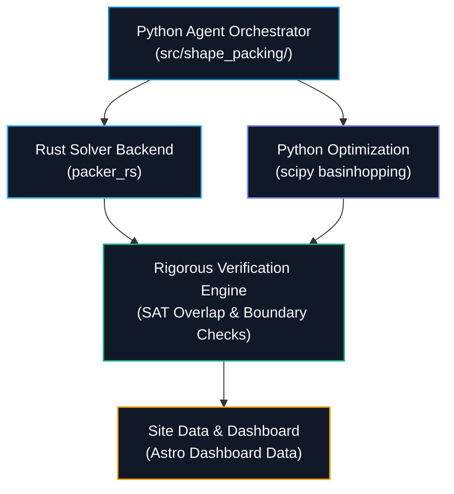

# Architecture & Engineering Design

The shape packing engine utilizes a decoupled, high-throughput architecture splitting execution between Python orchestration and Rust numerical optimization.

## System Architecture Diagram

## Key Components

1. **Agent Loop (`agent_loop.py`):** Selects candidate problems based on priority queue rankings and status gaps.
2. **Rust Solver (`packer_rs`):** Executes 10,000 to 100,000 random starts per second for non-overlapping polygon placements.
3. **Verification Layer (`verify_solution.py`):** Enforces float tolerances ($10^{-5}$ precision) using Separating Axis Theorem (SAT).
4. **Site Builder (`build_site_data.py`):** Aggregates solutions and benchmark status into JSON artifacts at build time.
