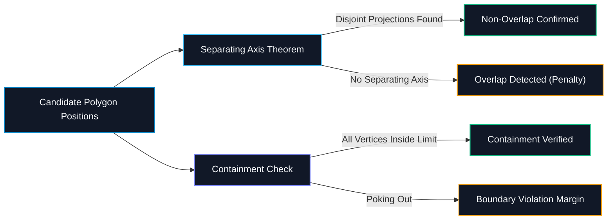

# Methodology & Mathematical Formulation

The packing problem aims to minimize the container size scale factor **S** (or maximize density) such that **N** identical shapes fit without overlapping.

## Metric Definition

Let `P_i(x_i, y_i, theta_i)` denote the position and rotation of the `i`-th shape.

The scale factor `S` represents the smallest container of unit dimensions that encloses all placed shapes:

- **Objective:** Minimize container scale factor `S`.
- **Non-Overlap Condition:** `Intersection(P_i, P_j) = Empty` for all `i != j`.
- **Containment Condition:** `P_i` is completely contained within `S * Container` for all `i`.

## Separating Axis Theorem (SAT)

For convex polygon shapes, non-overlap is verified by projecting vertices onto candidate normal vectors of all edges. If there exists at least one axis where projections are disjoint, the shapes do not overlap.

